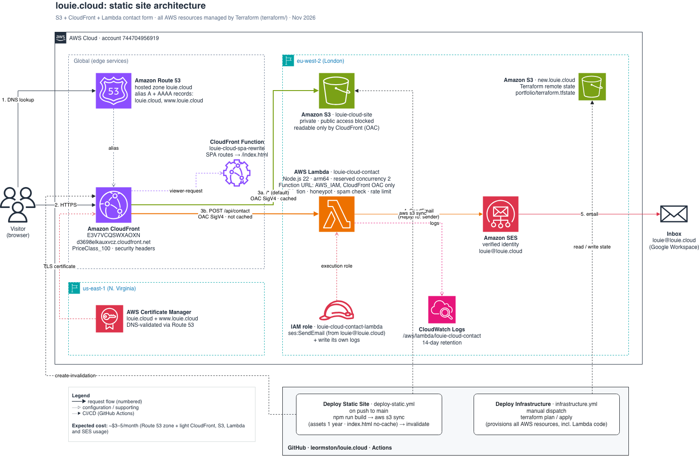

# louie.cloud

Personal portfolio website for Louie Ormston Demi — Software / DevOps / Cloud Engineer.

## Tech Stack

- **Frontend:** React 19, Vite, React Router. Blog posts are Markdown in `content/blog/`.
- **Hosting:** static site on S3 + CloudFront (eu-west-2), TLS via ACM.
- **Contact form:** one Lambda (`terraform/lambda/contact/`) behind CloudFront at `/api/contact`, sending email via SES.
- **Infrastructure:** Terraform in `terraform/`.
- **CI/CD:** GitHub Actions.

## Architecture



Source: [`docs/architecture.drawio`](docs/architecture.drawio). Edit it in draw.io / diagrams.net, then re-export the PNG.

## Getting Started

```bash
npm install
npm run dev
```

The contact form posts to `/api/contact`, which only exists behind CloudFront,
so it won't send locally.

## Deployment

- **Site:** every push to `main` runs [Deploy Static Site](.github/workflows/deploy-static.yml):
  build → upload to S3 → invalidate CloudFront.
- **Infrastructure / contact Lambda:** run [Deploy Infrastructure](.github/workflows/infrastructure.yml)
  manually (`plan` / `apply`). Changes to `terraform/lambda/contact/` are deployed this way too.

See [terraform/README.md](terraform/README.md) for details.

## Adding a blog post

Create a `.md` file in `content/blog/` (with frontmatter), add an entry to
`content/blog/index.json`, and push to `main`.
