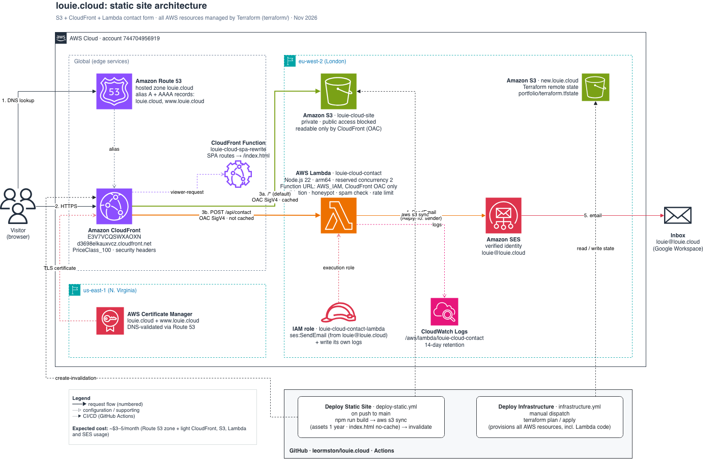

# Terraform: louie.cloud

Infrastructure for the static portfolio site.



## Architecture

```
louie.cloud / www  (Route 53 alias A + AAAA)
        │
   CloudFront  (ACM cert, security headers, PriceClass_100)
        ├── /*        → S3 bucket louie-cloud-site (private, OAC)
        │               CloudFront Function rewrites SPA routes → /index.html
        └── /api/*    → Lambda function URL louie-cloud-contact (IAM auth, OAC)
                         → SES email to louie@louie.cloud
```

| File | What's in it |
|---|---|
| `static_site.tf` | S3 bucket + policy, CloudFront distribution, SPA rewrite function, DNS records |
| `contact_lambda.tf` | Contact form Lambda, function URL, IAM role, log group (14 days) |
| `lambda/contact/index.mjs` | Contact form handler (validation, honeypot, spam checks, rate limit) |
| `certificate.tf` | ACM certificate for `louie.cloud` + `www` (us-east-1) and its DNS validation |
| `main.tf` | Providers and S3 remote state |

Remote state: `s3://new.louie.cloud/portfolio/terraform.tfstate` (eu-west-2).
The Route 53 hosted zone itself is not managed here (looked up as a data source).

## Applying changes

Normally via GitHub Actions: **Deploy Infrastructure** → `plan`, check the
output, then `apply`. It needs the `AWS_ACCESS_KEY_ID`,
`AWS_SECRET_ACCESS_KEY` and `DOMAIN_NAME` secrets.

Locally:

```bash
cd terraform
terraform init
terraform plan  -var domain_name=louie.cloud
terraform apply -var domain_name=louie.cloud
```

## Notes

- **Contact form requests must include `x-amz-content-sha256`** (SHA-256 of
  the POST body). CloudFront signs requests to the Lambda and needs it for POST
  bodies. The frontend does this in `src/components/jsx/contact.jsx`.
- The Lambda has no dependencies. It uses the AWS SDK v3 that comes with the
  Node.js 22 runtime, and Terraform zips `lambda/contact/` on apply.
- Lambda `reserved_concurrent_executions = 2` caps cost and abuse, and keeps the
  in-memory per-IP rate limit meaningful.
- Site files are uploaded by `.github/workflows/deploy-static.yml`, not by Terraform.
